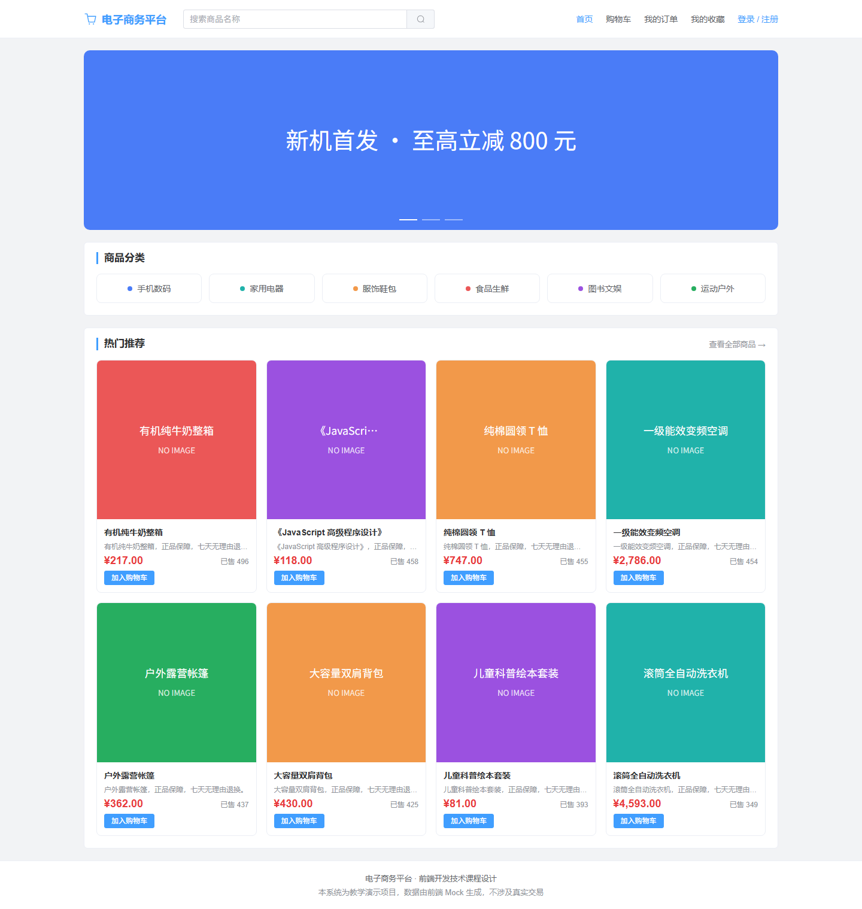
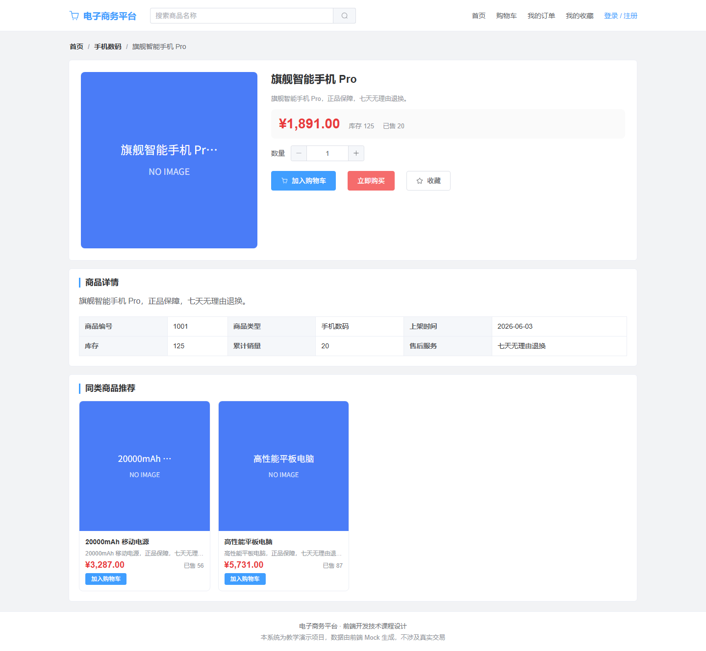
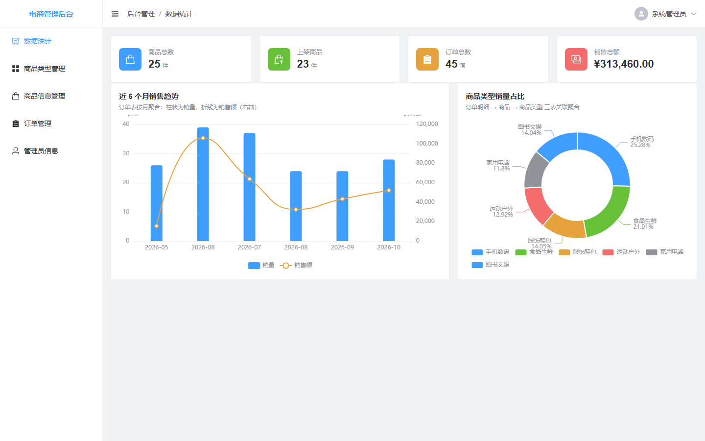
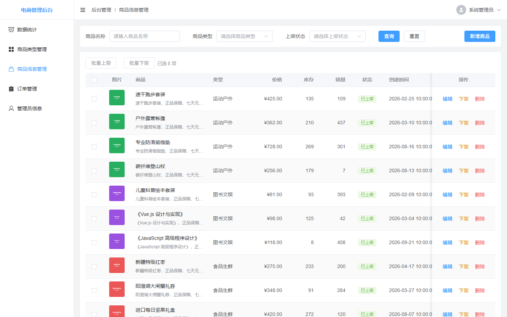
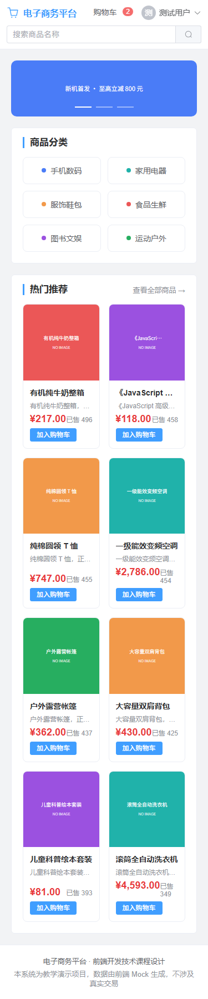
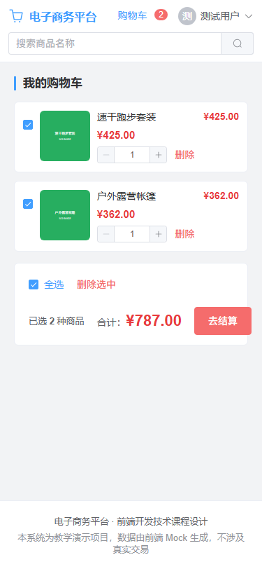
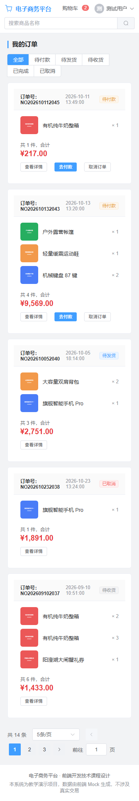

# 电子商务平台前端系统

> 前端开发技术课程设计（课程设计代码：25110631）
> 题目：**电子商务平台前端系统设计与实现**

一个包含「**电商前台商城**」与「**后台管理系统**」双端的单页应用。
前台面向购物用户，覆盖浏览 → 搜索 → 加购 → 下单 → 订单跟踪 → 收藏 → 个人中心的完整链路；
后台面向平台管理员，覆盖登录 → 数据统计 → 商品类型管理 → 商品管理 → 订单管理 → 管理员信息。

**数据来源为纯前端 Mock**（Node 原生 ESM 中间件 + 确定性种子数据），不依赖任何真实后端，克隆下来即可完整运行。

---

## 一、技术栈

| 分类 | 选型 | 说明 |
| --- | --- | --- |
| 构建工具 | **Vite 5** | 冷启动快、HMR 精准；未使用 Vue CLI |
| 框架 | **Vue 3.5**（组合式 API + `<script setup>`） | 全部页面为 SFC 单文件组件 |
| 语言 | **JavaScript + JSDoc** | 未引入 TypeScript，用 JSDoc 描述复杂结构 |
| 路由 | **Vue Router 4** | `createWebHistory` + 嵌套路由 + `meta` 驱动鉴权 + 路由级懒加载 |
| 状态管理 | **Pinia 3** + `pinia-plugin-persistedstate 4` | 统一 setup store 写法 |
| UI 组件库 | **Element Plus 2.8**（全量注册 + 中文语言包） | 见下方「已知约束」 |
| 图表 | **ECharts 5**（按需引入） | 自研 `useEcharts` 封装实例生命周期 |
| HTTP | **Axios** | 单例 + 双拦截器，统一响应契约 `{ code, message, data }` |
| 样式 | **SCSS** | 变量与 mixin 由 Vite 自动注入，无需重复 `@use` |
| 代码规范 | **ESLint 9（flat config）+ Prettier 3** | `npm run lint` / `npm run format` |

---

## 二、快速开始

```bash
# 1. 安装依赖（请使用 npm）
npm install

# 2. 启动开发服务器（默认 http://127.0.0.1:5173）
npm run dev

# 3. 生产构建
npm run build

# 4. 本地预览构建产物
npm run preview

# 5. 代码检查与格式化
npm run lint          # ESLint 检查
npm run format        # Prettier 格式化
```

**环境要求**：Node.js ≥ 18（推荐 20+）、npm ≥ 9。

### 演示账号

| 端 | 账号 | 密码 | 说明 |
| --- | --- | --- | --- |
| 后台管理端 | `admin` | `123456` | 管理员，可进入 `/admin/*` |
| 电商前台 | `test` | `123456` | 普通用户，可下单、收藏 |
| 电商前台 | `lisi` / `wangwu` | `123456` | 另两个普通用户，用于制造多用户订单数据 |

> 前台登录页与后台登录页均提供「一键填充」演示账号按钮，无需手输。

---

## 三、功能清单

### 电商前台（`/`）

| 模块 | 路由 | 主要能力 |
| --- | --- | --- |
| 首页 | `/home` | 轮播广告、商品类型快捷入口、热门推荐（按销量倒序） |
| 商品搜索 | `/search` | 关键字 + 类型筛选、综合/销量/价格排序、分页；条件由 URL 驱动，可分享可回退 |
| 商品详情 | `/goods/:id` | 主图、价格/库存/销量、数量选择、加入购物车、立即购买、收藏、商品参数、同类推荐 |
| 购物车 | `/cart` | 勾选/全选、数量增减、单个与批量删除、合计金额、去结算（数据存本地并持久化） |
| 订单确认 | `/order/confirm` | 收货信息表单（资料预填 + 手机号校验）、商品明细、提交订单 |
| 我的订单 | `/order/list` | 状态页签筛选、订单卡片、分页、模拟付款、取消订单 |
| 订单详情 | `/order/detail/:id` | 状态流转步骤条、订单信息、商品明细、收货信息、金额汇总 |
| 我的收藏 | `/favorite` | 收藏网格、取消收藏、快速加购 |
| 个人中心 | `/user/profile` | 头像上传、昵称与手机号修改 |
| 登录 / 注册 | `/login`、`/register` | 表单校验、注册后自动登录 |

### 后台管理（`/admin`）

| 模块 | 路由 | 主要能力 |
| --- | --- | --- |
| 管理员登录 | `/admin/login` | 账号密码登录、演示账号一键填充、已登录自动回跳工作台 |
| 数据统计 | `/admin/dashboard` | 4 张指标卡 + 近 6 个月销售趋势（柱状 + 折线双轴）+ 商品类型销量占比（环形图） |
| 商品类型管理 | `/admin/category` | 列表筛选分页、新增/编辑弹窗、删除二次确认（类型下有商品时禁止删除） |
| 商品信息管理 | `/admin/goods` | 多条件筛选、分页、批量上架/下架、行内上下架与删除、跳转新增/编辑页 |
| 商品新增/编辑 | `/admin/goods/create`、`/admin/goods/edit/:id` | 同一组件按路由参数区分模式，含图片上传（本地 Base64 回退） |
| 订单管理 | `/admin/order` | 订单号/状态筛选、分页、发货/完成/取消状态流转 |
| 订单详情 | `/admin/order/:id` | 订单信息、商品明细、收货信息、管理员操作 |
| 管理员信息 | `/admin/profile` | 资料查看与修改 |

### 页面预览

前台首页与商品详情（桌面 1440px）：




后台数据统计与商品管理：




窄屏适配（375px）：顶栏改为两行式、商品网格降为 2 列、购物车切换为卡片式：





> 全部 26 张截图见 [`docs/screenshots/`](./docs/screenshots/)。

---

## 四、目录结构

```
前端02/
├─ build/
│  └─ mock-server-plugin.js      # 自研 Vite Mock 中间件（dev 期拦截 /api/*）
├─ docs/
│  ├─ 电商平台前端-架构设计方案（三方案对比）.md
│  └─ screenshots/               # 各页面截图（含窄屏）
├─ public/
├─ src/
│  ├─ api/                       # 接口层（唯一与后端/Mock 交互的出口）
│  │  ├─ request.js              # Axios 单例 + 拦截器
│  │  ├─ admin/                  # 后台接口：auth / category / goods / order / stat
│  │  └─ before/                 # 前台接口：auth / goods / order
│  ├─ assets/styles/             # variables / mixins / element-override / index
│  ├─ components/
│  │  ├─ common/                 # 通用组件（7 个，前后台共用）
│  │  ├─ admin/                  # 后台业务组件（StatCard / SidebarCom / HeaderCom）
│  │  └─ before/                 # 前台业务组件（GoodsCard / AuthShell / OrderGoodsList）
│  ├─ composables/               # useTable / useDialog / useAuth / useEcharts / useMediaQuery
│  ├─ mock/
│  │  ├─ db.js                   # 确定性种子数据（mulberry32 + 固定种子）
│  │  ├─ helpers.js              # ok / fail / paginate / token 等工具
│  │  └─ modules/                # 8 个 Mock 接口模块（34 个接口）
│  ├─ router/
│  │  ├─ index.js                # 路由实例
│  │  ├─ guard.js                # 全局守卫（登录态 / 角色 / 标题）
│  │  └─ modules/                # admin.js / before.js
│  ├─ store/modules/             # user / app / cart / category / goods / order
│  ├─ utils/                     # constants / format / validate / file / theme
│  └─ views/
│     ├─ admin/                  # 后台页面
│     ├─ before/                 # 前台页面
│     ├─ demo/                   # 通用组件演示页（/demo）
│     └─ error/404.vue
├─ CLAUDE.md                     # 项目代码规范（11 章 + 附录 A~E）
├─ eslint.config.js
├─ vite.config.js
└─ package.json
```

---

## 五、Mock 数据说明

项目**不连接真实后端**，所有接口由自研的 Vite 中间件在开发期拦截并返回模拟数据。

### 为什么是自研中间件而不是 `vite-plugin-mock`

`vite-plugin-mock` 依赖 `bundle-require` 把每个 mock 文件打包成临时文件**写回源文件同级目录**，再加载、再删除。这带来两个致命问题：

1. 产物落在被 glob 扫描的目录里 → 热更新触发新一轮打包 → 临时文件数量逐轮翻倍（实测累积到 383 个文件 / 4.2 MB）；
2. 整个机制依赖「删除文件」这一动作，一旦删除被拦截（安全策略、权限、占用），**Mock 层会整体失效**。

自研实现改用 **Node 原生 ESM 动态 `import()`**（带 `?t=时间戳` 绕开模块缓存），**零临时文件、零删除动作**，可安全热重载。

### 数据特性

- **确定性种子**：用固定种子的伪随机数生成器构建数据，每次启动结果一致，便于截图与验收。
- **多表关联真实**：商品 ↔ 类型 ↔ 订单 ↔ 用户互相关联，图表与统计能对上账（例如「近 6 个月销售趋势」由订单表按月聚合得出）。
- **业务规则内置于 Mock**：如「类型下仍有商品不允许删除」「库存不足不允许下单」「订单取消会回滚库存与销量」，前端因此能真正测到错误分支。
- **数据驻留内存**：Mock 数据存活于 dev server 进程，刷新页面不丢，**重启 dev server 即还原为种子数据**。

### 环境变量

| 文件 | 变量 | 说明 |
| --- | --- | --- |
| `.env.development` | `VITE_API_BASE=/api`、`VITE_USE_MOCK=true` | 开发期启用 Mock |
| `.env.production` | `VITE_USE_MOCK=false` | 生产构建不打包 Mock 中间件 |

---

## 六、路由权限模型

路由 `meta` 字段与守卫执行顺序（`src/router/guard.js`）：

```
guestOnly → requiresAuth → role
```

| 字段 | 作用 |
| --- | --- |
| `requiresAuth` | 是否要求登录；未登录时跳对应登录页并携带 `redirect` |
| `role` | 要求的角色（`admin` / `user`），不匹配跳 `/404` |
| `guestOnly` | 仅游客可访问（登录/注册页）；已登录时按 `guestRedirect` 回跳 |
| `title` | 页面标题，同时用于后台侧边栏菜单文案与面包屑 |
| `icon` | 后台侧边栏图标名，与 `SidebarCom` 的 `ICON_MAP` 对应 |

> 后台侧边栏菜单**由路由表自动生成**：只要在 `router/modules/admin.js` 里给子路由配上 `meta.icon` 与 `meta.title`，菜单项即自动出现，无需改布局组件。

---

## 七、代码规范

全部约定见根目录 **[CLAUDE.md](./CLAUDE.md)**（11 章 + 附录 A~E），要点：

- 组件单文件 **> 300 行必须拆分**；通用组件禁止 import `api/*`，需接口时通过 props 注入。
- 业务组件可读 store / 调 api / 用 router，但**不允许跨子系统引用**（`views/admin` 与 `views/before` 不能互相 import 业务组件）。
- 样式统一用 SCSS + Element Plus CSS 变量，**禁止硬编码十六进制色值**；响应式用 `respond-to` / `respond-below` mixin。
- 副作用（事件监听、定时器）必须在 `onUnmounted` 中清理。

```bash
npm run lint     # 应输出零告警
npm run format   # 统一代码格式
```

---

## 八、已知约束

1. **Element Plus 采用全量注册**（`app.use(ElementPlus, { locale: zhCn })` + 全局 `index.css`），
   未使用 `unplugin-vue-components` 按需解析器。原因是按需解析器会与全局样式重复注入 CSS，
   且会让 Vite 依赖预构建频繁「发现新依赖 → 重新预构建」，实测会导致 dev server 崩溃。
   代价是 `vendor-element-plus` chunk 约 947 KB（gzip 304 KB）——属既定取舍。
2. Mock 数据在 dev server 进程内存中，**重启即重置**；如需保留请改造成真实后端。
3. 构建告警阈值调至 1100 KB，用于匹配上述 UI 库体积，避免无意义告警噪音。

---

## 九、相关文档

| 文档 | 内容 |
| --- | --- |
| [CLAUDE.md](./CLAUDE.md) | 项目代码规范：命名、SFC、composables、Pinia、API 层、路由权限、样式、Git、JSDoc、反模式、代码检查 + 附录 A~E |
| [docs/电商平台前端-架构设计方案（三方案对比）.md](./docs/电商平台前端-架构设计方案（三方案对比）.md) | 三套架构方案（单工程路由分区 / Monorepo / 微前端）的横向对比与落地推荐 |
| [docs/screenshots/](./docs/screenshots/) | 前后台各页面截图（含 375px 窄屏） |

---

## 十、设计参考

架构与工程组织参考了以下开源项目：

- [newbee-mall-vue3-app](https://github.com/newbee-ltd/newbee-mall-vue3-app) —— 前台商城的页面组织与购物车交互
- [v3-admin-vite](https://github.com/un-pany/v3-admin-vite) —— 后台布局、路由权限与目录分层
- [art-design-pro](https://github.com/Daymychen/art-design-pro) —— 通用组件抽象方式
- [vue3-shopadmin](https://github.com/1411430556/vue3-shopadmin) —— `api/` 按业务拆分与 `components/{common,business,layout}` 组织

---

## 十一、许可

本项目为课程设计教学用途，仅供学习参考。
